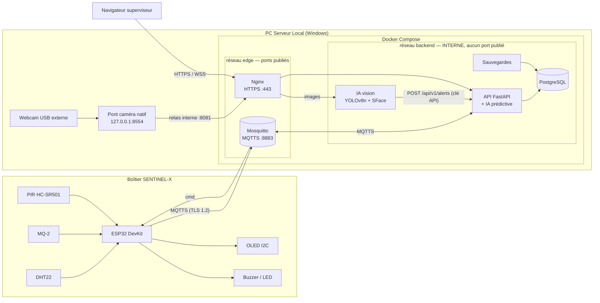

# 🛰️ SENTINEL-X — L'Avant-Poste Industriel du Futur

> Workshop national EPSI M1 — Session octobre 2026 — Groupe **G<n>**
> *« Sentinel-X : la sécurité à la bordure. »*

Prototype cyber-physique de surveillance autonome pour les micro-centrales AetherCorp : un boîtier Edge (**ESP32** + capteurs) communique de manière chiffrée (MQTTS) avec un **PC Serveur Local** qui centralise les données, exécute l'IA (vision + maintenance prédictive) et expose un dashboard de supervision temps réel en HTTPS.

---

## 📑 Sommaire

1. [Architecture](#-architecture)
2. [Choix techniques par brique](#-choix-techniques-par-brique)
3. [Structure du dépôt](#-structure-du-dépôt)
4. [Prérequis](#-prérequis)
5. [Installation & lancement](#-installation--lancement)
6. [API & contrat d'interface](#-api--contrat-dinterface)
7. [Intelligence artificielle](#-intelligence-artificielle)
8. [Sécurité](#-sécurité)
9. [Supervision & MCO](#-supervision--mco)
10. [Dépannage](#-dépannage)
11. [Conventions Git](#-conventions-git)
12. [Équipe](#-équipe)
13. [Livrables](#-livrables)

---

## 🏗️ Architecture

**Option matérielle retenue : B — Topologie distribuée « Edge-to-Server »** (*cf. §3 du cahier des charges*).
Le PC Serveur Local exécute toute la stack dans Docker Desktop (Windows). La webcam USB externe y est branchée.



### Réseau de table

Le boîtier et le PC serveur doivent être sur le **même réseau Wi-Fi 2,4 GHz en WPA2-PSK (AES)** : l'ESP32 ne voit pas le 5 GHz et ne gère pas le WPA2-Entreprise (réseaux d'école ou d'entreprise).

| Équipement | Adresse | Ports exposés |
|---|---|---|
| Point d'accès (passerelle) | attribuée par le point d'accès | — |
| PC Serveur Local | IP du PC sur ce réseau (inscrite dans les certificats) | `443` (HTTPS/WSS), `80` (redirection HTTPS), `8883` (MQTTS) |
| ESP32 | DHCP, ou IP fixe via `ESP_STATIC_IP` dans `secrets.h` | aucun |

**Point d'accès recommandé : un point d'accès matériel dédié** (partage de connexion d'un smartphone en 2,4 GHz, ou petit routeur Wi-Fi), configuré en WPA2-PSK avec un mot de passe fort. C'est la configuration validée en conditions réelles. Il suffit ensuite de :
1. connecter le PC serveur à ce réseau et relever son adresse (`ipconfig`) ;
2. inscrire cette adresse dans les certificats : `bash scripts/setup.sh --renew-certs <IP du PC>` puis `docker compose restart mqtt web` ;
3. renseigner `WIFI_SSID`, `WIFI_PASSWORD` et `MQTT_HOST` (= IP du PC) dans `edge-firmware/include/secrets.h`, puis flasher l'ESP32.

**Variante sans matériel supplémentaire : le point d'accès mobile Windows** (scripts fournis) :

| Rôle | Script | Ce qu'il applique |
|---|---|---|
| PC point d'accès (et serveur avec `-WithServer`) | `scripts\ap-hotspot.ps1` (admin) | SSID `SENTINEL-X`, WPA2-AES, 2,4 GHz, mot de passe aléatoire fort, passerelle `192.168.137.1` (réseau imposé par Windows 11), pas de coupure sans client, pare-feu : depuis la table, seuls DHCP/DNS (et 443/80/8883 avec `-WithServer`) atteignent ce PC |
| PC serveur séparé | `scripts\server-network.ps1` (admin) | Connexion à `SENTINEL-X`, IP fixe `192.168.137.10`, pare-feu **refus par défaut** : entrées autorisées uniquement 443/80/8883 depuis `192.168.137.0/24`, règles Docker « tous ports » désactivées |

> ⚠️ **Retour d'expérience** : le point d'accès mobile Windows partage l'unique radio Wi-Fi du portable avec sa connexion Internet. Dans une salle chargée (point d'accès de l'établissement sur le même canal 2,4 GHz), l'ESP32 s'y associait mais était déconnecté dès que des données TLS circulaient. Le même firmware et le même serveur fonctionnent de façon stable sur un point d'accès matériel (partage de connexion d'un smartphone sur un canal libre). Pour la démonstration, privilégier un point d'accès dédié.

**Pourquoi pas un point d'accès dans WSL ?** WSL 2 est une machine virtuelle sans accès à la carte Wi-Fi interne (PCIe) : `hostapd` ne peut pas l'utiliser, et les règles `iptables` de WSL ne voient pas le trafic du point d'accès Windows. Une passerelle Linux complète (`hostapd` + `dnsmasq` + `iptables`) demanderait une clé Wi-Fi USB transmise à WSL (`usbipd`) ou un PC démarré sous Linux.

---

## 🧩 Choix techniques par brique

### 1. Backend API & télémétrie (FastAPI / PostgreSQL / MQTT)
* **Fichiers** : `server-backend/app/` (`main.py` routes, `services.py` pont MQTT, `security.py`, `schemas.py`, `ml.py`).
* L'API est abonnée en **MQTTS** aux topics `sentinel/+/telemetry` et `sentinel/+/status`. Chaque message est validé (schéma strict, `node_id` en liste blanche, anti-rejeu par numéro de séquence), **horodaté par le serveur** puis enregistré dans PostgreSQL (SQLAlchemy, requêtes paramétrées).
* Les mesures, alertes et accusés de commande sont poussés au dashboard par **WebSocket** (`/ws/live`, authentifié).
* Les commandes du dashboard (`ALARM_ON`, `BEEP_2`…) passent par `POST /api/v1/actuators/control` (**admin**, réponse 202) puis MQTT `sentinel/<node>/cmd` ; le boîtier confirme via son topic de statut.
* **Réactions automatiques décidées par le serveur** (jamais par le navigateur) : mouvement PIR → alerte `MOTION` + 2 bips ; intrus caméra → alerte `INTRUDER` + 2 bips ; anomalie IA prédictive → alerte `ANOMALY` + mélodie 3 notes. Chaque réaction est limitée (front montant, délai minimal) pour éviter le spam.

### 2. Maintenance prédictive (Scikit-Learn / Pandas)
Conformément au cahier des charges qui interdit les seuils statiques (`if temp > 40`), la détection d'anomalies est **apprise**.
* **Fichier** : `server-backend/app/ml.py` (+ `train_model.py` en ligne de commande).
* **Isolation Forest** non supervisé sur `temp`, `hum`, `gas_raw`, entraîné depuis l'historique PostgreSQL (bouton *Administration → Entraîner le modèle*, cf. [IA](#-intelligence-artificielle)).
* Inférence sur **chaque** mesure reçue ; `predict() == -1` → alerte `ANOMALY` (CRITICAL) + mélodie sur le boîtier, au plus 1 par minute.
* Sensibilité réglable : `ML_CONTAMINATION` dans `.env` (0.01 par défaut ; 0.1 = plus sensible mais beaucoup plus de fausses alertes).
* Le fichier du modèle est **signé (HMAC-SHA256)** : un modèle altéré est refusé (un fichier pickle modifié pourrait exécuter du code).

### 3. IA de vision (YOLOv8 + OpenCV)
* **Fichiers** : `ai-engine/main.py` (conteneur) et `ai-engine/camera-bridge/bridge.py` (pont natif Windows).
* **YOLOv8n** détecte les personnes ; **YuNet + SFace** reconnaît les visages autorisés (`ai-engine/visages_autorises/`, similarité cosinus ≥ 0,363).
* **Toute présence humaine** confirmée sur 3 images déclenche une alerte : personne non identifiée → `INTRUDER` / CRITICAL ; visage autorisé → `MOTION` / INFO (« présence autorisée »).
* Docker Desktop sous Windows ne peut pas accéder à une webcam USB : le **pont caméra** lit la webcam externe (choisie par nom, la webcam intégrée est exclue) et transmet les images au conteneur via un relais Nginx interne. Le conteneur d'IA reste isolé (aucun port, aucun accès Internet).

### 4. Dashboard (React + Tailwind + Recharts)
* **Dossier** : `web-dashboard/` (voir son README).
* Connexion obligatoire (rôles **admin** / **opérateur** en lecture seule), mesures en direct, courbes 15 min → 24 h (une mesure par graphique, axes adaptés), flux caméra annoté, historique d'alertes filtrable, page **Système** (MCO), page **Administration** (entraînement de l'IA).
* Aucun seuil manuel dans l'interface (règle « pas de seuil statique »).

### 5. Micrologiciel ESP32 (PlatformIO / C++)
* **Fichier** : `edge-firmware/src/main.cpp` (détails et câblage : `edge-firmware/README.md`).
* Publie un JSON toutes les 2 s en **MQTTS** (certificat du broker vérifié par la CA interne), avec Last Will `{"online":false}`.
* Commandes validées (liste blanche) : `ALARM_ON` (sirène continue non bloquante), `ALARM_OFF`, `BEEP_2`, `BEEP_3` (mélodie Do-Mi-Sol), `LED_ON`, `LED_OFF`.

---

## 📁 Structure du dépôt

```
.
├── edge-firmware/          # Micrologiciel ESP32 (PlatformIO, C++)
├── server-backend/         # API REST + WebSocket + IA prédictive (FastAPI) — tests dans tests/
├── ai-engine/              # IA vision (conteneur) — modèles vérifiés par SHA-256
│   └── camera-bridge/      # Pont caméra natif Windows (webcam USB externe)
├── web-dashboard/          # Dashboard React, servi par Nginx
├── infra-cyber/            # Mosquitto (conf + ACL), Nginx, init PostgreSQL, sauvegardes
├── scripts/                # setup.sh, ap-hotspot.ps1, server-network.ps1, start-camera-bridge.ps1, verify-security.sh
├── docs/                   # Contrat d'interface, schémas, dossier technique
├── fablab/                 # CAO Fusion 360 + fichiers de gravure laser
├── docker-compose.yml      # Stack serveur complète (durcie)
├── docker-compose.camera.yml  # Variante hôte Linux (webcam montée directement)
└── .env.example            # Modèle de configuration (aucun secret)
```

Fichiers **générés localement et jamais versionnés** : `.env`, `secrets/`, `infra-cyber/certs/`, `edge-firmware/include/secrets.h`, `backups/`.

---

## ⚙️ Prérequis

**PC Serveur Local (Windows 10/11) :**

| Outil | Usage |
|---|---|
| Docker Desktop (backend **WSL 2**) | Toute la stack serveur |
| Git for Windows (Git Bash + OpenSSL) | `scripts/setup.sh`, `scripts/verify-security.sh` |
| Python 3.11+ | Pont caméra (`winget install Python.Python.3.12`) |
| VS Code + extension PlatformIO | Flasher l'ESP32 |
| Pilote **Silicon Labs CP210x** | Port COM de l'ESP32 (sinon « erreur 28 » dans le Gestionnaire de périphériques) |

**Matériel :** ESP32 DevKit v1, DHT22, MQ-2 (avec pont diviseur), PIR HC-SR501, OLED SSD1306, buzzer, LED, webcam USB.

---

## 🚀 Installation & lancement

Commandes à lancer depuis la racine du dépôt, dans **Git Bash** (sauf mention PowerShell).

### 0. Réseau de table
Allumer le point d'accès (2,4 GHz, WPA2-PSK — voir [Réseau de table](#réseau-de-table)), y connecter le PC serveur et relever son adresse IP avec `ipconfig`.

### 1. Cloner le dépôt (PC serveur)
```bash
git clone https://github.com/xPredatorxx/Sentinel-X.git
cd Sentinel-X
```

### 2. Générer secrets et certificats (une seule fois par PC serveur)
```bash
WIFI_SSID='<SSID du point d'accès>' WIFI_PASSWORD='<mot de passe>' bash scripts/setup.sh <IP du PC serveur>
```
Crée `.env`, `secrets/` (mots de passe et clés aléatoires), `infra-cyber/certs/` (CA interne + certificats HTTPS/MQTTS couvrant l'IP donnée) et `edge-firmware/include/secrets.h` (Wi-Fi, IP du serveur). **Les identifiants du dashboard sont affichés à la fin** (et restent dans `secrets/admin_password`, `secrets/viewer_password`).
Avec un point d'accès en DHCP, supprimer les deux lignes `ESP_STATIC_IP` / `ESP_GATEWAY` de `secrets.h` (elles visent le réseau `192.168.137.0/24` du point d'accès Windows).
Si l'IP du PC change : `bash scripts/setup.sh --renew-certs <nouvelle IP>`, `docker compose restart mqtt web`, mettre à jour `MQTT_HOST` dans `secrets.h` et reflasher.

### 2 bis. Variante point d'accès Windows (PowerShell administrateur)
```powershell
powershell -ExecutionPolicy Bypass -File scripts\ap-hotspot.ps1 -WithServer       # ce PC est point d'accès ET serveur (192.168.137.1)
powershell -ExecutionPolicy Bypass -File scripts\server-network.ps1 -WifiPassword '<mdp>'   # serveur séparé (192.168.137.10)
```

### 3. Lancer la stack
```bash
docker compose up -d --build
docker compose ps                     # les 6 services doivent être "healthy"
```

### 4. Démarrer le pont caméra (PowerShell)
```powershell
powershell -ExecutionPolicy Bypass -File scripts\start-camera-bridge.ps1             # démarre (crée son venv au 1er lancement)
powershell -ExecutionPolicy Bypass -File scripts\start-camera-bridge.ps1 -Autostart  # + à chaque ouverture de session
```
Webcam choisie par nom : variable `CAMERA_NAME` (défaut `UGREEN`). Sous Linux, sans pont : `docker compose -f docker-compose.yml -f docker-compose.camera.yml up -d`.

### 5. Flasher l'ESP32
1. Vérifier `edge-firmware/include/secrets.h` : `WIFI_SSID` / `WIFI_PASSWORD` du point d'accès, `MQTT_HOST` = IP du PC serveur (présente dans les certificats).
2. Brancher la carte en USB puis :
```bash
cd edge-firmware
pio run -t upload && pio device monitor     # attendu : [MQTT] Connexion TLS... OK
```

### 6. Ouvrir le dashboard
- `https://<IP du serveur>` — importer `infra-cyber/certs/ca.crt` dans les **autorités racines de confiance** (double-clic → Installer le certificat) pour supprimer l'avertissement du navigateur.
- Comptes : `admin` (commandes, entraînement IA) et `operateur` (lecture seule).

### 7. Entraîner l'IA prédictive (après ~10 min de fonctionnement normal)
*Administration → Entraîner le modèle* (ou `docker compose exec api python -m app.train_model`). Voir [IA](#-intelligence-artificielle).

### 8. Contrôler le durcissement
```bash
bash scripts/verify-security.sh       # 80+ contrôles : conteneurs, ports, TLS, en-têtes, ACL MQTT, pont caméra…
```

### Développement sans Docker
```bash
cd server-backend && python -m venv .venv && source .venv/Scripts/activate
pip install -r requirements.txt pytest && python -m pytest -q       # tests de sécurité / contrat
cd ../web-dashboard && npm ci && npm run dev                         # proxy Vite vers l'API locale
```

---

## 🔌 API & contrat d'interface

| Méthode | Endpoint | Accès | Rôle |
|---|---|---|---|
| `GET` | `/health` | public | Sonde de vie (aucune information interne) |
| `POST` | `/api/v1/auth/login` · `/logout` | public / session | Connexion (cookie HttpOnly) |
| `POST` | `/api/v1/alerts` | clé API IA ou admin | Création d'une alerte → **201** |
| `GET` | `/api/v1/alerts` | session | Dernières alertes |
| `GET` | `/api/v1/telemetry/latest` | session | Dernier état du boîtier |
| `GET` | `/api/v1/telemetry/history?range=15m\|1h\|6h\|24h` | session | Séries pour les courbes |
| `POST` | `/api/v1/actuators/control` | admin | Commande buzzer / LED → **202** |
| `GET` · `POST` | `/api/v1/ml/status` · `/api/v1/ml/train` | session · admin | IA prédictive |
| `GET` | `/api/v1/system/status` | session | Supervision (MCO) |
| `WSS` | `/ws/live` | session | Flux temps réel (lecture seule) |

**Topics MQTT** (le `node_id` est l'identifiant MQTT du boîtier, imposé par l'ACL) :

| Topic | Sens | Payload |
|---|---|---|
| `sentinel/<node_id>/telemetry` | ESP → serveur (2 s) | `{"seq","uptime_ms","temp","hum","gas_raw","gas_v","motion","rssi"}` |
| `sentinel/<node_id>/status` | ESP → serveur (retenu + Last Will) | `{"online","alarm","cmd_id","cmd","ok"}` |
| `sentinel/<node_id>/cmd` | serveur → ESP | `{"id","action"}` |

Codes HTTP : 200 lecture, 201 alerte créée, 202 commande transmise, 401 non authentifié, 403 interdit, 413 corps trop gros, 415 pas du JSON, 422 hors contrat, 429 trop de requêtes, 503 broker indisponible.

---

## 🧠 Intelligence artificielle

### Vision
- YOLOv8n (personnes) + YuNet/SFace (visages autorisés), une seule boucle d'inférence partagée par tous les spectateurs, toujours sur l'image la plus récente.
- Réglages (`docker-compose.yml`, service `ai`) : `YOLO_IMGSZ` (640 ; 320 pour un PC modeste), `INTRUDER_FRAMES` (3), `ALERT_COOLDOWN_S` (30).
- Ajouter une personne autorisée : déposer une photo nette du visage dans `ai-engine/visages_autorises/<prenom>.jpg` puis `docker compose restart ai`.

### Maintenance prédictive — quand et pourquoi entraîner ?
- **Ce que fait le modèle** : il apprend ce qui est *normal* pour ce boîtier dans cette pièce (combinaisons habituelles de température, humidité et gaz), puis signale une mesure qui sort de ce profil — sans aucun seuil fixe.
- **Les mesures sont correctes sans lui** : capteurs, courbes, alertes PIR et caméra fonctionnent indépendamment. Seule la détection d'anomalies (`ANOMALY`) est inactive tant qu'aucun modèle n'est entraîné (page Système : « Non entraîné »).
- **Quand l'entraîner** : après **au moins 10 minutes (300 mesures) de fonctionnement normal**, capteur MQ-2 préchauffé (1 à 3 min à chaque démarrage, 24 à 48 h la toute première fois). À refaire si le boîtier change de pièce ou de conditions, ou si les fausses alertes se multiplient.
- **Pourquoi réservé à l'admin** : l'entraînement définit ce que le système considère comme normal. Entraîné pendant un incident (fuite de gaz, chauffage), il apprendrait l'incident comme « normal » et ne le détecterait plus — c'est une action sensible.

---

## 🛡️ Sécurité

| Domaine | Mesure | Où |
|---|---|---|
| Conteneurs | Non-root, `no-new-privileges`, `cap_drop: ALL`, FS racine en lecture seule, limites mémoire/PID, aucun conteneur privilégié, pas de socket Docker | `docker-compose.yml` |
| Réseau Docker | Réseau `backend` **interne** (aucune sortie) ; seuls Nginx (443/80) et Mosquitto (8883) publient un port ; BDD, API et IA **sans port hôte** | `docker-compose.yml` |
| Webcam | Pont natif limité à `127.0.0.1`, jeton secret, lecture seule, webcam choisie par nom ; relais Nginx interne (port 8081 non publié) | `ai-engine/camera-bridge/` |
| Secrets | Docker secrets (fichiers `/run/secrets`), générés aléatoirement, jamais en variable d'environnement ni dans Git | `scripts/setup.sh`, `.gitignore` |
| HTTPS | TLS 1.2/1.3, ECDSA, HSTS, CSP stricte, `X-Frame-Options`, `nosniff`, `Referrer-Policy`, `Permissions-Policy`, version masquée, HTTP → HTTPS | `infra-cyber/nginx/` |
| MQTT | MQTTS uniquement (plus de port 1883), pas d'anonyme, mots de passe hachés, `use_username_as_clientid`, **ACL refus par défaut** : chaque ESP n'écrit que sa télémétrie et son statut et ne lit que ses commandes | `infra-cyber/mosquitto/` |
| Authentification | Argon2, cookie HttpOnly + Secure + SameSite=Strict, JWT HS256 (algorithme imposé), verrouillage après 5 échecs | `server-backend/app/security.py` |
| Autorisation | Rôles admin / opérateur / IA ; clé API de l'IA liée à un `node_id` et à 2 types d'alerte, inutilisable depuis l'extérieur ; WebSocket authentifié + contrôle d'origine | idem |
| Entrées | Pydantic strict (`extra=forbid`, énumérations, plages, pas de NaN), JSON uniquement (415), corps ≤ 16 Ko (413), liste blanche des `node_id`, anti-rejeu MQTT, horodatage serveur | `schemas.py`, `services.py` |
| CSRF / XSS | Origine + en-tête personnalisé exigés ; aucun rendu HTML de données reçues ; CSP `script-src 'self'` ; pas de CORS ouvert | `security.py`, `web-dashboard/` |
| Limitation de débit | Nginx (login 5/min, API 20/s) + API (par IP, par clé, par boîtier) | `nginx.conf`, `security.py` |
| Erreurs | Aucune trace d'appel renvoyée (500 générique), mot de passe jamais renvoyé dans un 422 | `main.py` |
| BDD | Rôle applicatif sans privilège d'administration, ORM paramétré, sauvegardes compressées avec rotation | `infra-cyber/postgres/`, `infra-cyber/backup/` |
| IA | Modèles embarqués et vérifiés par SHA-256 (aucun téléchargement), modèle prédictif signé HMAC, aucune commande système, sortie de l'IA revalidée par l'API | `ai-engine/`, `ml.py` |
| Dépendances | Versions figées ; `pip-audit` et `npm audit` : 0 vulnérabilité connue | `requirements.txt`, `package-lock.json` |

**Preuve reproductible** : `bash scripts/verify-security.sh` (conteneurs, ports, en-têtes, TLS, ACL MQTT prouvées de bout en bout, pont caméra, authentification, limitation de débit, secrets).

---

## 📈 Supervision & MCO

- **Healthchecks** Docker sur chaque service + redémarrage automatique (`restart: unless-stopped`).
- Page **Système** du dashboard : état de l'API, de la base, du broker, du boîtier (dernier contact), de l'IA vision (images/s, temps d'inférence) et du modèle prédictif ; compteurs (messages reçus / rejetés et dernier motif, alertes, commandes).
- **Journaux** : rotation automatique (3 × 10 Mo par service) — `docker compose logs -f api`.
- **Sauvegardes** : `pg_dump` toutes les 6 h dans `./backups/` (28 copies). Restauration :
  `docker compose exec backup sh /scripts/restore.sh sentinel-AAAAMMJJTHHMMSSZ.sql.gz`

---

## 🧰 Dépannage

| Symptôme | Cause / solution |
|---|---|
| Docker Desktop : « wsl is not installed » | PowerShell **administrateur** : `wsl --install --no-distribution`, puis redémarrer |
| Pas de port COM pour l'ESP32 (« erreur 28 ») | Installer le pilote Silicon Labs CP210x |
| L'ESP n'obtient pas d'IP | Point d'accès arrêté ou en 5 GHz : relancer `scripts\ap-hotspot.ps1` sur le PC point d'accès (force 2,4 GHz) ; vérifier `WIFI_PASSWORD` dans `secrets.h` |
| `[MQTT] ... tls=...` dans le moniteur série | `MQTT_HOST` absent des certificats : relancer `bash scripts/setup.sh --renew-certs <IP>` et redémarrer `mqtt` |
| Tuile caméra « CAMERA HORS LIGNE » | Pont caméra non démarré (`scripts\start-camera-bridge.ps1`) ou webcam d'un autre nom (`CAMERA_NAME`) ; journal : `ai-engine\camera-bridge\bridge.log` |
| Dashboard injoignable depuis un autre appareil | L'appareil doit être connecté au réseau de table (un Wi-Fi d'école isole les clients entre eux) ; ouvrir `https://<IP du PC serveur>` ; importer `ca.crt` pour éviter l'avertissement |
| Point d'accès mobile Windows qui ne démarre plus | Configuration du service effacée : PowerShell admin `reg delete "HKLM\SYSTEM\CurrentControlSet\Services\icssvc\Settings" /f ; Restart-Service icssvc` puis relancer `ap-hotspot.ps1` ; sinon *Paramètres → Réseau → Réinitialisation du réseau* |
| Fausses alertes `ANOMALY` répétées | Modèle entraîné trop tôt (capteur pas préchauffé) : réentraîner après 10 min stables |

---

## 🌿 Conventions Git

- `main` reste toujours démontrable.
- Une branche par tâche : `feat/<scope>-<sujet>`, `fix/<scope>-<sujet>`.
- Merge via Pull Request relue par un membre d'un autre pilier.
- Commits au format [Conventional Commits](https://www.conventionalcommits.org/) : `feat(api): ...`, `fix(firmware): ...`, `chore(infra): ...`

Scopes : `firmware`, `api`, `ia`, `dashboard`, `infra`, `cyber`, `fablab`, `docs`.

---

## 👥 Équipe

| Membre | Pilier | Responsabilités |
|---|---|---|
| Romain | IA & Data | API back-end, maintenance prédictive |
| Rémi | IA | Vision (webcam), intégration IA |
| `TODO` | DEV | Firmware ESP32 |
| `TODO` | DEV | Dashboard |
| `TODO` | INFRA | Docker Compose, réseau, monitoring |
| `TODO` | CYBER | TLS, hardening, audit |

---

## 📦 Livrables

Dossier de rendu : `Workshop2026-M1-G<n>/`

| Livrable | Fichier |
|---|---|
| Rapport d'ingénierie technique | `Workshop2026-M1-G<n>-Dossier.pdf` |
| Support de présentation | `Workshop2026-M1-G<n>-Pres.pptx` |
| Teaser « Sentinel Drop » | `Workshop2026-M1-G<n>-VidDrop.mp4` |
| Archive du code | `Workshop2026-M1-G<n>-Code.zip` |
